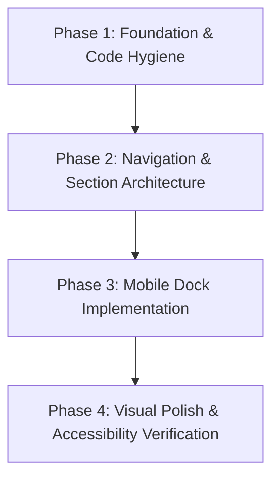

# Comprehensive UI/UX, Frontend & Architectural Audit Report

**Project:** Ryuk (Personal Knowledge Operating System & Portfolio)  
**Audit Date:** September 10, 2026  
**Auditors:** Senior UI/UX Designer, UX Architect, Frontend Developer & Code Reviewer Agents  
**Target Codebase:** `apps/web` (Next.js 16.3.2 Turbopack, React 19.2.8, Tailwind CSS v4, Framer Motion 13.2)  
**Output Document:** `UI-UX-AUDIT.md`

---

## Executive Summary

Ryuk has an exceptional aesthetic premise: combining a minimalist personal knowledge operating system with a high-polish developer portfolio. The ambient warm radial glows, serif italics on hero headlines, and floating pill navigation establish a distinctive brand identity.

However, the current codebase suffers from **severe functional and design fragmentation**:
1. **Broken Navigation & Phantom Anchors:** The marketing page currently only consists of a Hero section and a Footer. Every navigation anchor link (`#work`, `#about`, `#playground`, `#resource`, `#release`) targets non-existent DOM elements.
2. **Disconnected Design Languages:** The landing page uses a sleek, pill-shaped design system with OKLCH variables and backdrop blurs, while the authentication pages (`/login`, `/signup`) and dashboard components use a completely disconnected 0px-radius, hardcoded dark Zinc styling with no light theme support.
3. **Mobile Disenfranchisement:** On mobile viewports (< 768px), the dashboard sidebar is completely hidden (`hidden md:flex`), and the dashboard header hides the toggle button (`hidden md:flex`), rendering the dashboard entirely unusable on mobile devices. On the landing page, the top mobile hamburger menu drops down directly over the main hero headline and primary CTA buttons.
4. **Dependency & Linter Hazards:** An obscure third-party npm package (`cn@0.2.6`) is installed and imported instead of a standard `clsx` + `tailwind-merge` utility. Unused variables in `bookmarks/page.tsx` and synchronous `setState` within an effect in `theme-toggle.tsx` cause `pnpm run lint` to fail with exit code 1.
5. **Broken Routing:** Upon logging in, users are redirected to `/dashboard`, but the dashboard page route was deleted, resulting in an immediate 404 error.
6. **Missing Favicon:** Deletion of `favicon.ico` triggers a 404 console error on every single browser page load.

Below is the comprehensive audit across all 5 evaluation dimensions, complete issue logs with line-level citations, an in-depth architecture specification for the requested **Mobile Bottom Navigation Dock**, and a phased implementation roadmap.

---

## 1. Top 10 UI/UX Improvements

| Rank | Improvement | Impact Area | Priority | Rationale |
|---|---|---|---|---|
| **1** | **Implement Missing Landing Page Sections** (`#work`, `#about`, `#playground`, `#resource`, `#contact`) | UX & Navigation | 🔴 Critical | All header and footer links are currently dead anchor links pointing to nowhere. |
| **2** | **Implement Mobile-Only Floating Bottom Dock** with Safe Area & Thumb-Reach Ergonomics | Mobile UX | 🔴 Critical | Mobile users struggle to reach the top navigation pill; the existing top drawer covers critical hero copy. |
| **3** | **Fix Broken Route & Mobile Dashboard Navigation** | Correctness & UX | 🔴 Critical | `/login` redirects to non-existent `/dashboard` (404); dashboard on mobile (< 768px) has zero navigation. |
| **4** | **Unify Design System & Tokens across Auth, Dashboard, and Marketing** | Visual Consistency | 🟠 High | Auth and Bookmark pages use hardcoded `zinc-950` / `bg-black`, completely breaking light mode and visual cohesion. |
| **5** | **Replace External `cn` Package with Native `clsx` + `tailwind-merge`** | Code Hygiene | 🟠 High | Eliminates risky supply-chain package and restores standard shadcn/tailwind class merging. |
| **6** | **Resolve Touch Target Deficits (< 44px)** on Mobile Toggles & Buttons | Accessibility | 🟠 High | Theme toggle and menu toggle measure ~30px, failing WCAG 2.5.5 touch target size criteria. |
| **7** | **Add Form Input Labels & Accessible Names** for Screen Readers | Accessibility | 🟠 High | Auth inputs and bookmark inputs rely exclusively on placeholders, violating WCAG 3.3.2. |
| **8** | **Fix `next/image` Implementation & Provide Favicon** | Performance & Stability | 🟡 Medium | `BookmarkCard` invokes `<Image />` without dimensions or domain permissions; missing `favicon.ico` causes 404 errors. |
| **9** | **Refactor `ThemeToggle` to Avoid Cascading Renders** | Code Quality & CWV | 🟡 Medium | Fixes ESLint `react-hooks/set-state-in-effect` and eliminates layout shift during hydration. |
| **10** | **Add `prefers-reduced-motion` Support** for Framer Motion & CSS Keyframes | Inclusive Design | 🟡 Medium | Respects vestibule disorder accessibility preferences across animations and drawer transitions. |

---

## 2. Detailed Audit Issues by Category

### Category 1: Visual Design

#### Issue V-01: Hardcoded Brutalist Zinc Styling in Auth Pages Breaks Design Token System
- **Priority:** 🔴 Critical
- **File:** `apps/web/app/(auth)/login/page.tsx` (Lines 46–47, 59, 67, 86, 94, 102) & `apps/web/app/(auth)/signup/page.tsx` (Lines 51–52, 64, 72, 90, 98, 106, 118)
- **Current Problem:** The auth pages use hardcoded arbitrary Tailwind classes (`bg-black`, `bg-zinc-950`, `border-zinc-800`, `text-zinc-100`, `bg-white text-black`, `rounded-none`) completely bypassing the CSS variables in `globals.css` (`--background`, `--foreground`, `--card`, `--border`, `--primary`, `--radius`).
- **Why It Matters:** In light mode, navigating to `/login` or `/signup` abruptly plunges the user into a pitch-black brutalist box with sharp corners, destroying brand continuity and visual harmony.
- **Recommended Solution:** Replace hardcoded zinc utilities with design tokens: `bg-background text-foreground`, card container with `rounded-xl border border-border bg-card shadow-sm`, and inputs/buttons using `@/components/ui/input` and `@/components/ui/button`.
- **Expected Result:** Seamless theme adaptation (light and dark mode) matching the refined pill and card aesthetic of the rest of the application.

#### Issue V-02: Hardcoded Accent Hex Colors instead of Semantic Tokens
- **Priority:** 🟡 Medium
- **File:** `apps/web/app/website/hero.tsx` (Lines 64, 137)
- **Current Problem:** The orange serif italic text and preview badge dot use hardcoded inline hex values: `text-[#ea580c] dark:text-[#f97316]` and `bg-[#ea580c]`.
- **Why It Matters:** Colors cannot be themed centrally, adjusted in design tokens, or audited for contrast compliance across alternative themes.
- **Recommended Solution:** Define semantic color tokens in `globals.css`:
  ```css
  :root { --brand-orange: oklch(0.62 0.22 39.5); }
  .dark { --brand-orange: oklch(0.70 0.21 41.0); }
  ```
  And expose `--color-brand-orange: var(--brand-orange)` in `@theme inline`.
- **Expected Result:** Centralized brand accent management without scattered arbitrary hex codes.

#### Issue V-03: Arbitrary Blur and Glassmorphism Token Fragmentation
- **Priority:** 🟢 Low
- **File:** `apps/web/app/website/nav.tsx` (Lines 30, 96), `apps/web/app/website/hero.tsx` (Lines 43, 94)
- **Current Problem:** Different components use mismatched backdrop filters and background opacities: `backdrop-blur-md bg-card/85`, `backdrop-blur-xs bg-card/70`, `backdrop-blur-md bg-card/80`, and `backdrop-blur-xl bg-card/95`.
- **Why It Matters:** Creates visual inconsistency across glass surfaces and causes redundant GPU composition layers.
- **Recommended Solution:** Standardize on two glassmorphism variants in CSS utility classes or component tokens: `--glass-pill` (`backdrop-blur-md bg-card/80 border border-border/80`) and `--glass-drawer` (`backdrop-blur-xl bg-card/90 border border-border`).
- **Expected Result:** Uniform visual elevation, frosted blur, and lighting reflections.

#### Issue V-04: Inconsistent Border Radius System
- **Priority:** 🟡 Medium
- **File:** Codebase-wide (`hero.tsx`, `nav.tsx`, `button.tsx`, `login/page.tsx`, `sidebar.tsx`)
- **Current Problem:** Four contradictory border radius strategies are in simultaneous use:
  1. `rounded-full` (nav pill, hero pill, CTA buttons)
  2. `rounded-xl` (hero mockup card, mobile drawer)
  3. `rounded-md` (buttons in `button.tsx`, inputs in `input.tsx`, sidebar nav items)
  4. `rounded-none` (auth cards, auth inputs, auth buttons, bookmark cards)
- **Why It Matters:** Visual dissonance between rounded and sharp components makes the app feel assembled from disparate UI kits without unified creative direction.
- **Recommended Solution:** Adopt the design token radius scale from `globals.css`:
  - Containers & Cards: `rounded-2xl` / `rounded-xl`
  - Controls (Buttons, Inputs): `rounded-lg` or `rounded-full` (based on component hierarchy)
  - Tags & Badges: `rounded-md` / `rounded-full`
- **Expected Result:** Cohesive curvature and rhythm across all routes.

#### Issue V-05: Dark Mode Shadows Lack Elevation Contrast
- **Priority:** 🟢 Low
- **File:** `apps/web/app/globals.css` (Lines 107–120)
- **Current Problem:** In `.dark`, shadow color is defined as `--shadow-color: hsl(0 0% 0%)`. When rendering over pure black background `oklch(0 0 0)`, black drop shadows are completely invisible.
- **Why It Matters:** Elevated elements (modals, dropdowns, cards) lose depth perception and spatial hierarchy in dark mode.
- **Recommended Solution:** In dark mode, augment elevation with subtle border highlights (`border-white/10`) or inner glow / surface brightness steps (`oklch(0.14 0 0)` to `oklch(0.18 0 0)`).
- **Expected Result:** Distinct visual hierarchy and layer separation in dark mode.

---

### Category 2: Responsive Design

#### Issue R-01: Total Dashboard Mobile Navigation Blackout
- **Priority:** 🔴 Critical
- **File:** `apps/web/src/components/layout/sidebar.tsx` (Line 65) & `apps/web/src/components/layout/dashboard-header.tsx` (Line 22)
- **Current Problem:** `Sidebar` is marked `hidden md:flex`. In `DashboardHeader`, the only sidebar toggle control is also wrapped in `hidden md:flex`.
- **Why It Matters:** Any user accessing `/bookmarks`, `/notes`, or `/setting` on a viewport narrower than 768px has NO menu, NO sidebar, and NO navigation links. They cannot navigate between app sections or access account settings.
- **Recommended Solution:** Provide a responsive mobile navigation drawer or integrate dashboard links into a mobile bottom navigation dock.
- **Expected Result:** 100% feature and navigation parity across mobile, tablet, and desktop viewports.

#### Issue R-02: Landing Page Top Mobile Drawer Occludes Hero Section & CTA
- **Priority:** 🔴 Critical
- **File:** `apps/web/app/website/nav.tsx` (Lines 95–138)
- **Current Problem:** When a mobile user taps the hamburger button at the top right, the drawer expands downwards (`max-w-sm mt-2 p-4 bg-card/95`), completely covering the main H1 headline and visually overlapping the hero CTA buttons.
- **Why It Matters:** Users lose context of where they are, and cannot preview the page while deciding where to navigate. Furthermore, thumb reach to top-right is ergonomically strained.
- **Recommended Solution:** Replace the top mobile menu with a floating bottom navigation dock situated comfortably within the natural thumb zone.
- **Expected Result:** Unobstructed content view with thumb-accessible navigation.

#### Issue R-03: Sub-44px Touch Targets on Mobile Controls
- **Priority:** 🟠 High
- **File:** `apps/web/src/components/ui/menu-toggle.tsx` (Line 18), `apps/web/src/components/ui/theme-toggle.tsx` (Line 30), `apps/web/app/website/hero.tsx` (Line 43)
- **Current Problem:** 
  - `MenuToggle` has `size={18}` and `p-1.5` (~30px total bounding box).
  - `ThemeToggle` has `size={18}` and `p-1.5` (~30px total bounding box).
  - Release pill in Hero has `py-1` (~26px touch height).
- **Why It Matters:** Violates WCAG 2.5.5 (Target Size - Enhanced, 44x44px) and WCAG 2.5.8 (Target Size - Minimum, 24x24px with spacing). Mobile users on touchscreens frequently mis-tap or fail to trigger the buttons.
- **Recommended Solution:** Increase button touch targets to minimum `min-h-[44px] min-w-[44px]` with flex centering, or add pseudo-element touch expansion (`after:absolute after:-inset-2`).
- **Expected Result:** Effortless, error-free tapping on mobile and tablet touchscreens.

#### Issue R-04: Extreme Viewport Overflow & Clipping on Narrow Devices (< 360px)
- **Priority:** 🟡 Medium
- **File:** `apps/web/app/website/hero.tsx` (Line 62) & `apps/web/app/website/nav.tsx` (Line 30)
- **Current Problem:** On small devices (e.g. Samsung Galaxy Z Fold at 320px or 340px width), the H1 heading `text-3xl min-[400px]:text-4xl sm:text-6xl` with `tracking-[-0.035em]` and `leading-[1.1]` causes awkward multi-line hyphenation and word breaking. In `nav.tsx`, the pill padding (`gap-3 p-1.5 pl-2 pr-2`) crowds the logo, theme toggle, and menu toggle.
- **Why It Matters:** Degraded first impression for users on compact mobile devices.
- **Recommended Solution:** Use clamp-based typography: `text-[clamp(1.75rem,7vw,3.5rem)]` and ensure fluid container padding (`px-3 sm:px-6`).
- **Expected Result:** Fluid, beautiful typography scaling continuously down to 300px without awkward wrapping.

---

### Category 3: User Experience & Accessibility

#### Issue U-01: Non-Existent Sections / Dead Anchor Links
- **Priority:** 🔴 Critical
- **File:** `apps/web/app/website/nav.tsx` (Lines 9–12), `apps/web/app/website/footer.tsx` (Lines 4–7), `apps/web/app/website/hero.tsx` (Line 42)
- **Current Problem:** 
  - Nav links point to `#work`, `#about`, `#playground`, `#resource`.
  - Footer links point to `#work`, `#about`, `#playground`, `#resource`.
  - Hero release pill points to `#release`.
  - None of these DOM IDs exist on `apps/web/app/(site)/page.tsx`.
- **Why It Matters:** Users click these links and experience zero feedback, zero scrolling, and zero content. This creates an immediate impression of a broken, unfinished site.
- **Recommended Solution:** Build the corresponding sections on the landing page:
  - `<section id="work">` (Projects showcase / Portfolio)
  - `<section id="about">` (Developer bio / background)
  - `<section id="playground">` (Interactive OS widgets / Activity feed)
  - `<section id="resource">` (Curated bookmarks, articles, notes)
  - `<section id="contact">` (Direct outreach form / contact cards)
- **Expected Result:** Smooth scroll navigation with active section tracking as the user traverses the page.

#### Issue U-02: Missing Form Labels Violates Screen Reader Accessibility (WCAG 3.3.2)
- **Priority:** 🟠 High
- **File:** `apps/web/app/(auth)/login/page.tsx` (Lines 80–95), `apps/web/app/(auth)/signup/page.tsx` (Lines 85–107), `apps/web/src/features/bookmarks/components/bookmark-form.tsx` (Lines 46–64)
- **Current Problem:** Form fields rely solely on `placeholder="..."` with no `<label>`, `aria-label`, or `aria-labelledby`.
- **Why It Matters:** Screen readers cannot announce the purpose of the input field. In addition, when users type, placeholders vanish, eliminating cognitive reference for users with memory or attention impairments.
- **Recommended Solution:** Add accessible `<label htmlFor="...">` elements (visible or visually hidden via `sr-only`), and attach proper `id` attributes to inputs.
- **Expected Result:** WCAG 2.1 AA compliance and clear screen reader announcements.

#### Issue U-03: Poor Color Contrast on Status Badges and Ambient Taglines
- **Priority:** 🟠 High
- **File:** `apps/web/app/website/hero.tsx` (Lines 48–50, 130–132)
- **Current Problem:** 
  - Release pill icon uses `text-chart-1` (yellow/amber `oklch(0.81 0.17 75.35)` on light background, having a contrast ratio below 2:1 against light card backgrounds).
  - `#backend` and `#design` tags use `text-[10px] text-muted-foreground bg-muted`.
- **Why It Matters:** Fails WCAG AA minimum contrast ratio (4.5:1 for normal text, 3:1 for graphical elements). Unreadable in bright ambient light or for low-vision users.
- **Recommended Solution:** Adjust light mode chart/amber accent to a darker shade (e.g. `oklch(0.55 0.18 55)`) and increase tag text contrast to `--foreground/80`.
- **Expected Result:** High contrast, legible UI elements across all lighting conditions.

#### Issue U-04: Mobile Menu Outside-Click & Escape Dismissal Gaps
- **Priority:** 🟡 Medium
- **File:** `apps/web/app/website/nav.tsx` (Lines 19–25, 95)
- **Current Problem:** While `nav.tsx` attaches a `keydown` listener for `Escape`, there is no backdrop overlay and no outside-click detection.
- **Why It Matters:** On mobile devices where there is no physical Escape key, users tapping outside the open menu expect it to dismiss. Currently, it remains open and traps the view.
- **Recommended Solution:** Add a transparent or blurred full-screen backdrop overlay (`<div onClick={() => setIsOpen(false)} className="fixed inset-0 z-40 bg-black/20 backdrop-blur-xs" />`) and attach an outside-click hook.
- **Expected Result:** Natural, intuitive modal/drawer dismissal on touch devices.

#### Issue U-05: Hardcoded Personal Email Dominating Navigation
- **Priority:** 🟡 Medium
- **File:** `apps/web/app/website/nav.tsx` (Line 75, 114) & `apps/web/app/website/footer.tsx` (Line 61)
- **Current Problem:** `ihyaet@gmail.com` is hardcoded as a prominent pill button in both the desktop navbar and mobile drawer.
- **Why It Matters:** 
  1. Hardcoding personal emails in UI markup exposes the address to scrapers and prevents white-labeling or configurable profiles.
  2. The email text takes up substantial horizontal navbar real estate that should be dedicated to core navigation items.
- **Recommended Solution:** Replace the text with a sleek "Get in Touch" / "Contact" button or an email icon button with a tooltip, and read contact information from a centralized configuration file (`site.config.ts`).
- **Expected Result:** Cleaner navbar geometry and configurable contact endpoints.

---

### Category 4: Code Quality & Architecture

#### Issue C-01: Accidental Dependency on Obscure NPM Package `cn`
- **Priority:** 🟠 High
- **File:** `apps/web/package.json` (Line 23), `apps/web/src/lib/utils.ts` (Line 1), `apps/web/src/components/ui/button.tsx` (Line 3), `apps/web/src/components/ui/input.tsx` (Line 2)
- **Current Problem:** `package.json` contains `"cn": "^0.2.6"`, and `src/lib/utils.ts` does `export { cn } from "cn";`. In addition, `button.tsx` and `input.tsx` directly import `from "cn"` rather than `@/lib/utils`.
- **Why It Matters:** 
  1. `cn@0.2.6` is an unverified third-party utility rather than the canonical Tailwind utility.
  2. `clsx` and `tailwind-merge` are already installed in `package.json` but bypassed.
  3. Direct imports from `"cn"` bypass custom class merge logic and TypeScript alias resolution.
- **Recommended Solution:**
  1. Update `apps/web/src/lib/utils.ts`:
     ```ts
     import { clsx, type ClassValue } from "clsx";
     import { twMerge } from "tailwind-merge";
     export function cn(...inputs: ClassValue[]) {
       return twMerge(clsx(inputs));
     }
     ```
  2. Change imports in `button.tsx` and `input.tsx` to `import { cn } from "@/lib/utils";`.
  3. Uninstall `cn` dependency: `pnpm --filter web remove cn`.
- **Expected Result:** Standard, secure, high-performance Tailwind class resolution.

#### Issue C-02: Linter Failure: Unused Variables & React 19 State in Effect Warning
- **Priority:** 🟠 High
- **File:** `apps/web/app/(dashboard)/bookmarks/page.tsx` (Lines 4, 10) & `apps/web/src/components/ui/theme-toggle.tsx` (Line 13)
- **Current Problem:** Running `pnpm run lint` fails with exit code 1 due to:
  1. `BookmarkForm` is defined but never used in `bookmarks/page.tsx`.
  2. `initialBookmarks` is assigned but never used in `bookmarks/page.tsx`.
  3. `setMounted(true)` called synchronously inside `useEffect` in `theme-toggle.tsx`, triggering `react-hooks/set-state-in-effect`.
- **Why It Matters:** Breaks continuous integration (CI) pipelines and causes unnecessary client cascading renders.
- **Recommended Solution:**
  1. Render `BookmarkForm` and the initial bookmark list in `bookmarks/page.tsx`.
  2. In `theme-toggle.tsx`, handle mounting safely without redundant synchronous re-renders, or use CSS-based icon visibility (e.g. `.dark & .sun-icon { display: block; }`).
- **Expected Result:** `pnpm run lint` passes with 0 warnings and 0 errors.

#### Issue C-03: Broken Post-Login Redirection (`/dashboard` 404)
- **Priority:** 🔴 Critical
- **File:** `apps/web/app/(auth)/login/page.tsx` (Line 31)
- **Current Problem:** Upon successful Supabase login, the code runs `router.push("/dashboard")`. However, `apps/web/app/(dashboard)/dashboard/page.tsx` was deleted from the repository.
- **Why It Matters:** Any user who signs in is immediately confronted with Next.js 404 page.
- **Recommended Solution:** Either add a redirect from `/dashboard` to `/bookmarks` in `next.config.js` / middleware, or change `router.push("/dashboard")` to `router.push("/bookmarks")`.
- **Expected Result:** Seamless post-authentication transition to the user's bookmark workspace.

#### Issue C-04: Missing `favicon.ico` Generates Continuous 404 Console Errors
- **Priority:** 🟡 Medium
- **File:** `apps/web/app/` / `apps/web/public/`
- **Current Problem:** `favicon.ico` was deleted in git commit `0a30b75`. When the browser loads any page, it requests `/favicon.ico`, resulting in HTTP 404 and a browser console error.
- **Why It Matters:** Pollutes browser logs and harms SEO audits and Core Web Vitals diagnostics.
- **Recommended Solution:** Generate and place an optimized `favicon.ico` and SVG icon in `apps/web/app/` or `apps/web/public/`.
- **Expected Result:** 0 console errors on initial page load.

#### Issue C-05: Missing Dimensions and Host Configuration in `BookmarkCard` `<Image />`
- **Priority:** 🟡 Medium
- **File:** `apps/web/src/features/bookmarks/components/bookmark-card.tsx` (Lines 17–22)
- **Current Problem:** `<Image src={bookmark.faviconUrl} alt="" className="w-4 h-4 mt-0.5 rounded-sm shrink-0" />` is used without `width` and `height` props. Additionally, external favicon URLs are not configured in `images.remotePatterns` in `next.config.js`.
- **Why It Matters:** Next.js `<Image>` will throw a runtime runtime error or fail to build when encountering external URLs that aren't pre-configured in `next.config.js`.
- **Recommended Solution:** Either use a regular `` tag with `loading="lazy"` for unconstrained dynamic favicons, or use an icon fallback proxy with fixed width/height.
- **Expected Result:** Reliable rendering of site favicons without Next.js image domain exceptions.

---

## 3. Mobile Dock Architecture & Specification

The audit requires a dedicated architectural blueprint for a **mobile-only bottom navigation dock**. This section provides the technical, interaction, and visual design specifications to guide implementation.

### 3.1 Design Objective & User Experience
- **Form Factor:** A floating, rounded pill dock anchored at the bottom of the mobile viewport, elevated above the device safe area (`env(safe-area-inset-bottom)`).
- **Default State (Collapsed):** A sleek, compact glassmorphic pill (~56px height) displaying:
  1. Quick navigation icon / avatar (left)
  2. Active section label or indicator (center)
  3. Expand / Menu toggle button (right)
- **Expanded State:** When tapped, the pill expands upwards with a spring animation (`framer-motion`), revealing a staggered list of section options:
  - 🏠 **Home** (`#hero` / `/`)
  - 👤 **About** (`#about`)
  - 💼 **Projects** (`#work`)
  - ⚡ **Activity** (`#playground` / `#activity`)
  - 📬 **Contact** (`#contact`)
  - 🌓 **Theme Toggle** & 🔐 **Auth Action**
- **Interaction Rules:**
  - Active section is highlighted in real-time via `IntersectionObserver` scroll-spy.
  - Tapping an item triggers smooth scrolling to that section and automatically collapses the dock.
  - Tapping outside the expanded dock or pressing `Escape` immediately collapses the menu.
  - Gestures: Swiping down on the expanded pill smoothly dismisses it.

---

### 3.2 Visual Aesthetics & Glassmorphism Specs
```css
/* Mobile Dock Visual System */
.mobile-dock {
  background: color-mix(in oklch, var(--card) 80%, transparent);
  backdrop-filter: blur(16px) saturate(180%);
  -webkit-backdrop-filter: blur(16px) saturate(180%);
  border: 1px solid color-mix(in oklch, var(--border) 70%, transparent);
  box-shadow: 
    0 10px 25px -5px hsl(0 0% 0% / 0.15),
    0 8px 10px -6px hsl(0 0% 0% / 0.1),
    inset 0 1px 0 0 hsl(0 0% 100% / 0.1);
}

.dark .mobile-dock {
  background: color-mix(in oklch, var(--card) 75%, transparent);
  border: 1px solid color-mix(in oklch, var(--border) 90%, transparent);
  box-shadow: 
    0 12px 30px -5px hsl(0 0% 0% / 0.5),
    0 4px 6px -2px hsl(0 0% 0% / 0.3),
    inset 0 1px 0 0 hsl(0 0% 100% / 0.08);
}
```

---

### 3.3 Recommended Component Structure
```
apps/web/src/components/layout/
├── mobile-dock/
│   ├── index.tsx                # Main export (<MobileDock />)
│   ├── dock-trigger.tsx         # Collapsed bar with active indicator & toggle
│   ├── dock-menu.tsx            # Expanded sheet with staggered animated items
│   ├── dock-item.tsx            # Individual accessible nav link with icon
│   └── use-active-section.ts    # Scroll-spy hook tracking active anchor in viewport
```

#### Component Hierarchy
```tsx
<MobileDockContainer> (fixed bottom-4 inset-x-0 z-50 flex justify-center md:hidden)
  <AnimatePresence>
    {isExpanded && <DockBackdrop onClick={collapse} />}
  </AnimatePresence>

  <motion.nav 
    layout 
    role="navigation" 
    aria-label="Mobile Navigation Dock"
    className="mobile-dock rounded-full ..."
  >
    {/* Collapsed Pill Content */}
    <DockTrigger ... />

    {/* Expanded Staggered Items */}
    <AnimatePresence>
      {isExpanded && (
        <motion.div className="dock-expanded-content">
          {navItems.map((item, index) => (
            <DockItem key={item.id} index={index} ... />
          ))}
        </motion.div>
      )}
    </AnimatePresence>
  </motion.nav>
</MobileDockContainer>
```

---

### 3.4 Animation & Motion Behavior (`framer-motion`)
- **Container Transition:**
  ```ts
  transition: {
    type: "spring",
    damping: 26,
    stiffness: 300,
    mass: 0.8
  }
  ```
- **Staggered Items Transition:**
  ```ts
  const menuVariants = {
    hidden: { opacity: 0, height: 0 },
    visible: {
      opacity: 1,
      height: "auto",
      transition: {
        staggerChildren: 0.04,
        delayChildren: 0.05
      }
    }
  };

  const itemVariants = {
    hidden: { opacity: 0, y: 12, scale: 0.95 },
    visible: { 
      opacity: 1, 
      y: 0, 
      scale: 1,
      transition: { type: "spring", damping: 20, stiffness: 350 }
    }
  };
  ```
- **Reduced Motion Support (`useReducedMotion`):**
  When `prefers-reduced-motion: reduce` is enabled, spring and translation animations are disabled in favor of simple opacity fades (`duration: 0.15s`).

---

### 3.5 Responsive Breakpoint & Layout Safety
- **Visibility:** `block md:hidden`. Strictly hidden on viewports $\ge$ 768px (`md` breakpoint). On desktop, the existing top floating navbar pill remains the primary navigation.
- **Bottom Safe Area Padding:**
  ```css
  bottom: max(1rem, env(safe-area-inset-bottom, 1rem));
  ```
- **Page Layout Accommodations:**
  To prevent the fixed bottom dock from obscuring footer text or content on mobile, add bottom padding to `<main>` and `<footer>`:
  ```tsx
  <main className="flex-1 w-full pb-24 md:pb-0">
  ```

---

### 3.6 Accessibility (a11y) Specifications
1. **ARIA Roles & State:**
   - Dock container: `<nav role="navigation" aria-label="Mobile Navigation Dock">`.
   - Expand toggle: `<button aria-expanded={isExpanded} aria-controls="mobile-dock-menu" aria-label={isExpanded ? "Close navigation menu" : "Open navigation menu"}>`.
   - Active section: Links set `aria-current={isActive ? "location" : undefined}`.
2. **Keyboard Trapping & Escape Listener:**
   - When expanded, pressing `Escape` collapses the dock.
   - Focus is retained inside the expanded dock when navigating via Tab.
3. **Touch Targets:**
   - Every interactive dock icon and menu link has a minimum bounding box of **$48\times 48\text{px}$** (exceeding the 44px WCAG guideline).

---

### 3.7 Potential Layout Conflicts & Mitigation
| Conflict | Risk | Mitigation Strategy |
|---|---|---|
| **Conflict with Top Mobile Menu** | Redundant duplicate menus causing cognitive overload. | Remove the top mobile hamburger menu in `nav.tsx`. Keep the top pill on mobile solely for Brand Logo and Theme Toggle (or completely hide top bar on mobile in favor of the bottom dock). |
| **Footer Content Obscured** | Dock floats directly on top of copyright text or footer links. | Add `pb-28` to `apps/web/app/website/footer.tsx` on mobile (`pb-28 sm:pb-12`). |
| **Next.js Dev Indicator Clash** | Dev indicator button renders at bottom right. | Center the dock horizontally using `left-1/2 -translate-x-1/2` with width constrained to `w-[calc(100%-2rem)] max-w-sm`. |
| **Virtual Keyboard Occlusion** | When an input is focused, bottom dock might cover inputs. | Listen to `visualViewport.resize` event and temporarily hide dock while keyboard is active. |

---

### 3.8 Exact Files to Modify for Mobile Dock Integration
1. `apps/web/src/components/layout/mobile-dock/index.tsx` *(New component)*
2. `apps/web/src/components/layout/mobile-dock/use-active-section.ts` *(New hook for scroll-spy)*
3. `apps/web/app/website/nav.tsx` *(Remove top hamburger dropdown on mobile to prevent conflicts)*
4. `apps/web/app/(site)/page.tsx` *(Include `<MobileDock />` in page tree)*
5. `apps/web/app/website/footer.tsx` *(Add bottom safe padding `pb-28 md:pb-12`)*

---

## 4. Problem Area Breakdowns

### 4.1 Typography Problems
1. **Unconstrained H1 Scaling on Mobile:**
   `text-3xl min-[400px]:text-4xl sm:text-6xl md:text-7xl lg:text-8xl` with `leading-[1.1] sm:leading-[0.96]`. On viewports between 320px and 399px, the text breaks awkwardly across 4 lines with cramped ascenders.
2. **Generic Unstyled Fallback Serif:**
   `font-serif italic font-normal text-[#ea580c]` defaults to standard system Georgia or Times New Roman. A custom editorial display font (e.g. Playfair Display, Instrument Serif, or Cormorant Garamond) would elevate the luxury aesthetic.
3. **Illegible Micro-Typography in Mockup:**
   Badges in `hero.tsx` and `sidebar.tsx` use `text-[10px]` and `text-[11px]`. On high-DPI mobile screens, sub-12px text suffers from poor legibility.

### 4.2 Spacing and Alignment Problems
1. **Vertical Section Imbalance:**
   The landing page transitions abruptly from the Hero preview card directly into the footer without adequate transitional whitespace or narrative flow.
2. **Horizontal Padding Inconsistencies:**
   - Nav pill: `px-3 sm:px-4`
   - Hero: `px-4 sm:px-6`
   - Mockup card: `p-4 sm:p-6`
   - Auth pages: `px-4 p-6`
   - Dashboard main: `p-4 md:p-6`
   A unified container padding scale (`px-4 sm:px-6 lg:px-8`) is needed.
3. **CTA Button Alignment Flaws:**
   In `hero.tsx:77`, buttons use `flex flex-col min-[420px]:flex-row`. On devices between 360px and 419px, the buttons stack vertically while taking full width, creating an unnecessarily tall block directly above the preview card.

### 4.3 Accessibility Problems
1. **Missing `<label>` tags on All Form Inputs:** Auth forms and bookmark form lack labels or `aria-label`.
2. **Touch Targets Under 44px:** Theme toggle and mobile menu toggle measure ~30px.
3. **Low Contrast on Yellow/Amber Accent Icons:** Amber star icon fails 3:1 contrast against light background.
4. **No Focus-Visible Rings on Custom Icon Buttons:** Icon buttons in `theme-toggle.tsx` and `menu-toggle.tsx` lack `focus-visible:ring-2` outline states for keyboard navigators.
5. **No `prefers-reduced-motion` Handling:** Framer Motion spring physics run unconditionally.

### 4.4 Performance Problems
1. **Favicon 404 Round-Trip Penalty:** Every page visit triggers a failed HTTP request for `/favicon.ico`.
2. **Unused Font File in Repository:** `GeistVF.woff` (66 KB) resides in `apps/web/app/fonts/` but is never referenced or loaded.
3. **React 19 Cascading Re-render in Theme Toggle:** Calling `setMounted(true)` synchronously inside `useEffect` causes a duplicate render pass on every initial client mount.
4. **Unoptimized Dynamic Favicons in Bookmarks:** `<Image />` without defined sizes or fallback causes runtime layout instability.

---

## 5. Recommended Implementation Roadmap

To execute the necessary fixes and implement the mobile dock with maximum stability and zero regressions, follow this sequential 4-phase plan:



### Phase 1: Foundation & Code Hygiene (Immediate)
- [ ] Replace external `cn` package with canonical `clsx` + `tailwind-merge` utility in `apps/web/src/lib/utils.ts`.
- [ ] Fix ESLint warnings in `apps/web/app/(dashboard)/bookmarks/page.tsx` and `apps/web/src/components/ui/theme-toggle.tsx`.
- [ ] Fix post-login redirect in `login/page.tsx` from `/dashboard` to `/bookmarks`.
- [ ] Add `favicon.ico` and SVG icon to resolve 404 console errors.
- [ ] Remove unused `GeistVF.woff` or integrate it as primary font variable.

### Phase 2: Landing Page Sections & Visual Unification
- [ ] Refactor `apps/web/app/(auth)/login/page.tsx` and `signup/page.tsx` to use design system tokens and light/dark theme variables.
- [ ] Implement the missing landing page sections in `apps/web/app/(site)/page.tsx`:
  - `#work`: Projects / Portfolio Showcase
  - `#about`: Developer Bio & Philosophy
  - `#playground`: Interactive Knowledge OS widgets & Activity
  - `#resource`: Curated tools and bookmarks
  - `#contact`: Contact form & social channels
- [ ] Add accessible `<label>` elements to all form fields.

### Phase 3: Mobile Bottom Navigation Dock
- [ ] Create `apps/web/src/components/layout/mobile-dock/` component suite.
- [ ] Implement `useActiveSection` IntersectionObserver hook for real-time anchor tracking.
- [ ] Add spring-based expanding and collapsing animations with `framer-motion`.
- [ ] Add `prefers-reduced-motion` fallback.
- [ ] Remove redundant mobile top drawer in `apps/web/app/website/nav.tsx`.
- [ ] Add bottom safe area padding (`pb-28`) to `footer.tsx` and `page.tsx`.

### Phase 4: Dashboard Mobile Navigation & Polish
- [ ] Provide responsive mobile drawer or bottom sheet for `DashboardSidebar` so mobile dashboard users can navigate.
- [ ] Add proper focus-visible outlines (`ring-2 ring-ring ring-offset-2`) across all interactive icon buttons.
- [ ] Run full automated verification (`pnpm run check-types`, `pnpm run lint`, `pnpm run build`).
- [ ] Perform cross-browser and mobile viewport audits in Playwright.

---

*Report prepared and compiled in accordance with the Ryuk UX/UI, Frontend Engineering, and Code Review agent directives.*
